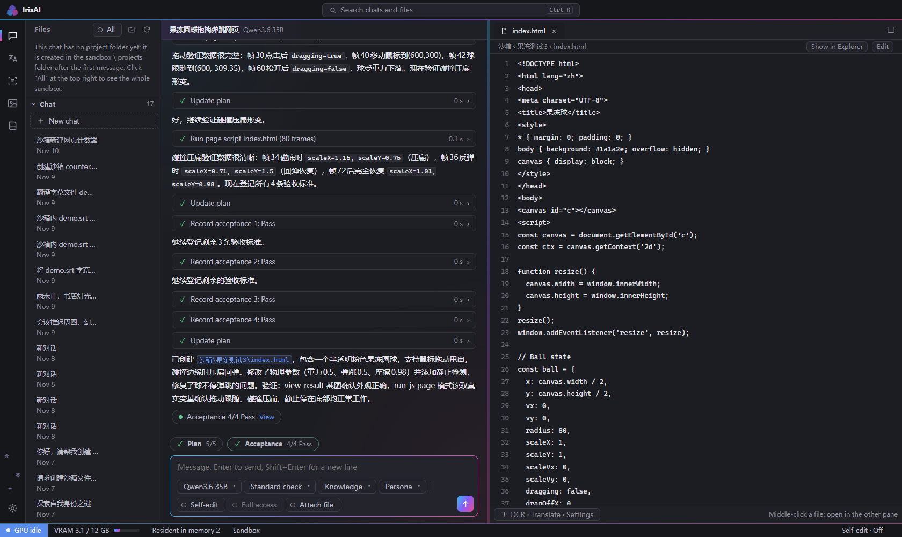
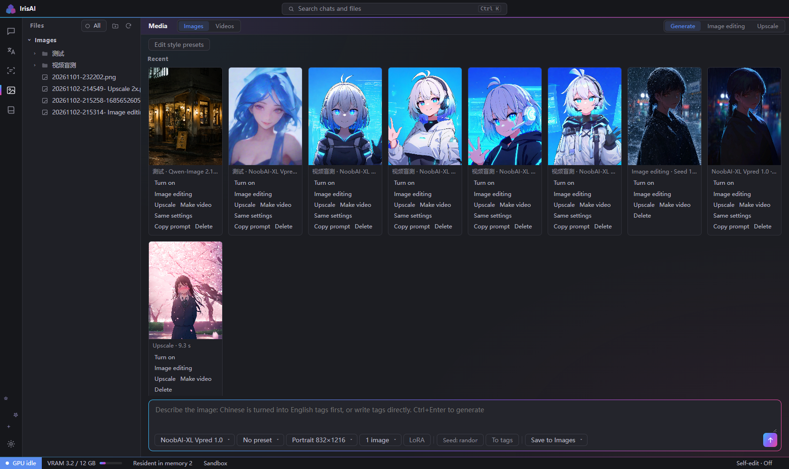
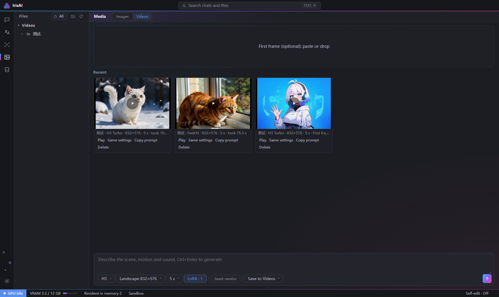
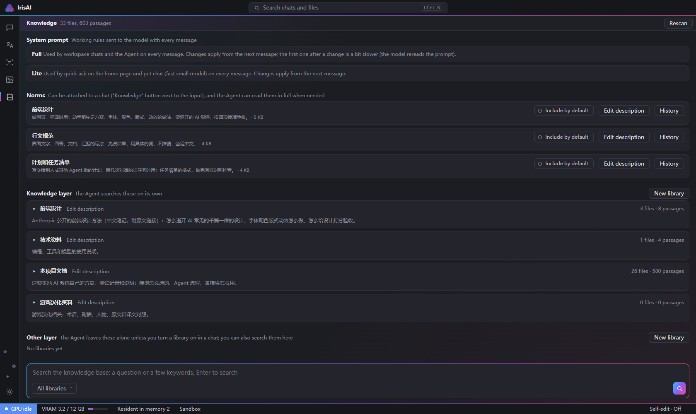
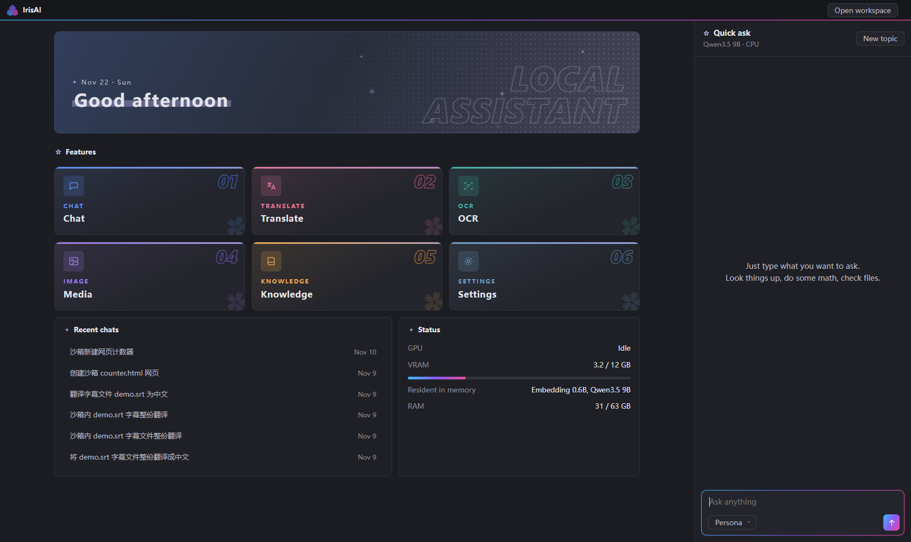
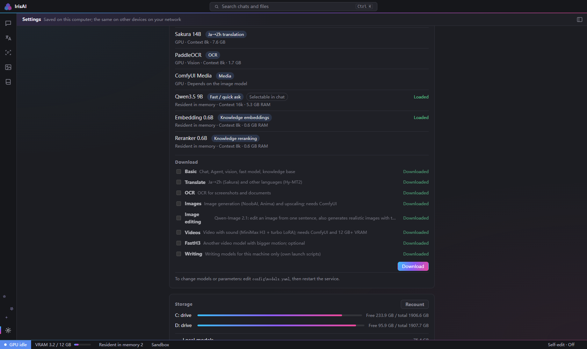

# IrisAI

[中文](README.md) | English

An all-in-one local AI workspace for Windows: chat and an agent, translation, OCR, image and video generation, and a knowledge base. All models run on your own computer; apart from web search, nothing is sent out. The interface is in Chinese or English, switchable in Settings.

## Features

**Chat and agent.** The agent reads and writes files in a sandbox folder, runs Python and page scripts, and searches the web. For tasks that produce files, it first sets acceptance criteria, verifies each one with code and screenshots when done, and then a reviewer who can't see the chat checks the evidence again. Writing or deleting outside the sandbox asks you first.

**Images and video.** Images are generated with ComfyUI: NoobAI and Anima for anime styles, Qwen-Image 2.1 for realistic pictures or pictures that need text in them. You can also edit an image with one sentence and upscale 2× or 4×. Video uses MiniMax H3, with sound, optionally starting from a first frame; a 5-second 832×576 clip takes about 105 s on a 12 GB GPU. You can add your own LoRAs by dragging them into the LoRA panel.

**Translation.** Paste text, or translate txt, srt, ass, docx and epub files; the translation is saved as a new file. Japanese uses Sakura, other languages Hy-MT2. Glossaries are supported.

**OCR.** Paste a screenshot or drop an image to recognize text, tables and formulas, then translate the result or ask about the image.

**Knowledge base.** Put files in the `knowledge` folder and the agent searches them on its own. Norms (writing rules, design rules) can be attached to a chat. The system prompt lives here too and can be edited directly.

**Home page and desktop app.** The home page has a small model resident in memory for quick questions; the desktop app is its own window and minimizes to the tray.

## Requirements

| Item | Requirement |
|---|---|
| System | Windows 10 or 11 |
| GPU | NVIDIA, 12 GB VRAM (the default models are chosen for this; with less, pick smaller models in `config\models.yaml`) |
| RAM | 32 GB or more |
| Disk | About 32 GB for the basic set, about 155 GB for everything |
| Python | 3.11 or later (the installer offers to install 3.12 with winget) |

## Install

1. Download or clone this repository.
2. Double-click `安装.bat` (install). It creates the Python environment, generates a sign-in password, lists the models by feature, and lets you pick what to download. Missing llama.cpp, llama-swap and ComfyUI are downloaded too. The installer's messages are in Chinese for now.
3. When it's done, double-click IrisAI on the desktop (the installer asks whether to add the shortcut), or open `http://127.0.0.1:8088` in a browser. The password is in `config\api_key.txt`. To switch the interface to English: Settings → Appearance → Language.

Downloads can be interrupted; run `安装.bat` again to resume. To add features later, tick them under Settings → Models → Download.

| Group | Contents | Size |
|---|---|---|
| Basic (required) | Chat and agent (Qwen3.6 35B), fast model (Qwen3.5 9B), knowledge embeddings and reranker | 30 GB |
| Translate | Sakura 14B, Hy-MT2 7B | 16 GB |
| OCR | PaddleOCR-VL 1.6 | 2 GB |
| Images | NoobAI-XL, Anima 2.9B, RealESRGAN | 12 GB |
| Image editing | Qwen-Image 2.1 (editing, also used for realistic images and images with text) | 17 GB |
| Video | MiniMax H3, turbo LoRA | 44 GB |
| FastH3 | Another video model with bigger motion | 22 GB |

## Use

- If the service isn't running, the desktop app starts it; the installer can also set it to start with Windows.
- LAN access: set `host` in `config\hub.json` to `0.0.0.0`, restart the service, and open `http://<this computer's IP>:8088`.
- The GPU holds one model at a time and switches automatically between features; idle models unload after 15 minutes.
- The chat API is OpenAI-compatible: `http://127.0.0.1:8080/v1`, with the header `Authorization: Bearer <password>`.

## Changing models

All models are listed in `config\models.yaml` (copied from `config\models.example.yaml` on first install): each model's files, parameters, purpose and download source, and which model each feature uses. Restart the service after editing; the scheduler config is regenerated from it. Every field is explained in the file.

## Themes

Settings lets you change the language (Chinese, English), light or dark mode, accent color, corner radius and font size. In English, the agent also replies in English by default. To make your own theme, see [themes/README.md](themes/README.md).

## Folders

| Location | Contents |
|---|---|
| `hub\` | Web service (Python) and web pages |
| `scripts\` | Install, download, startup, desktop app |
| `config\` | Example configs; your own config and password also live here and are not uploaded |
| `sandbox\` | The agent's working folder; generated images, videos and translations go here |
| `knowledge\` | Knowledge base, norms, personas, system prompt |

## License

The code is MIT-licensed. The bundled marked and DOMPurify keep their own licenses. Each model has its own license; check the model page before downloading. Qwen-Image 2.1 is non-commercial only.
