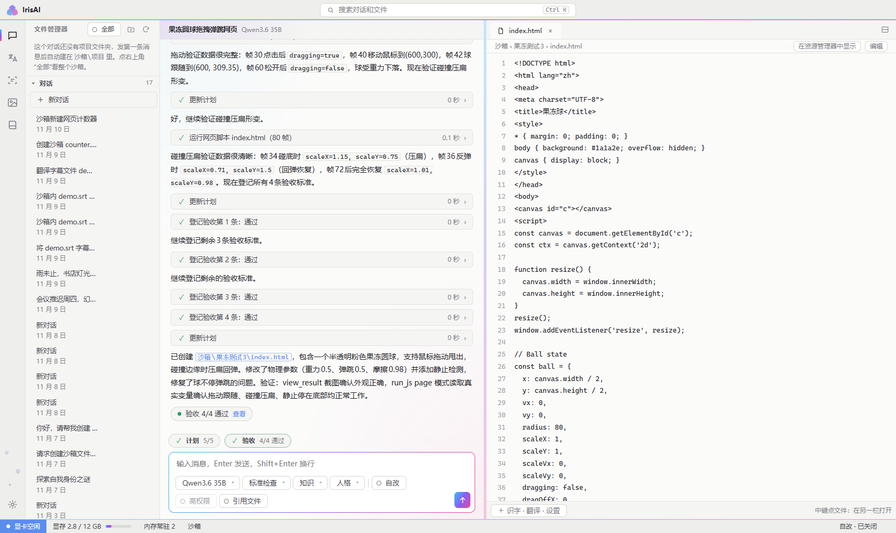
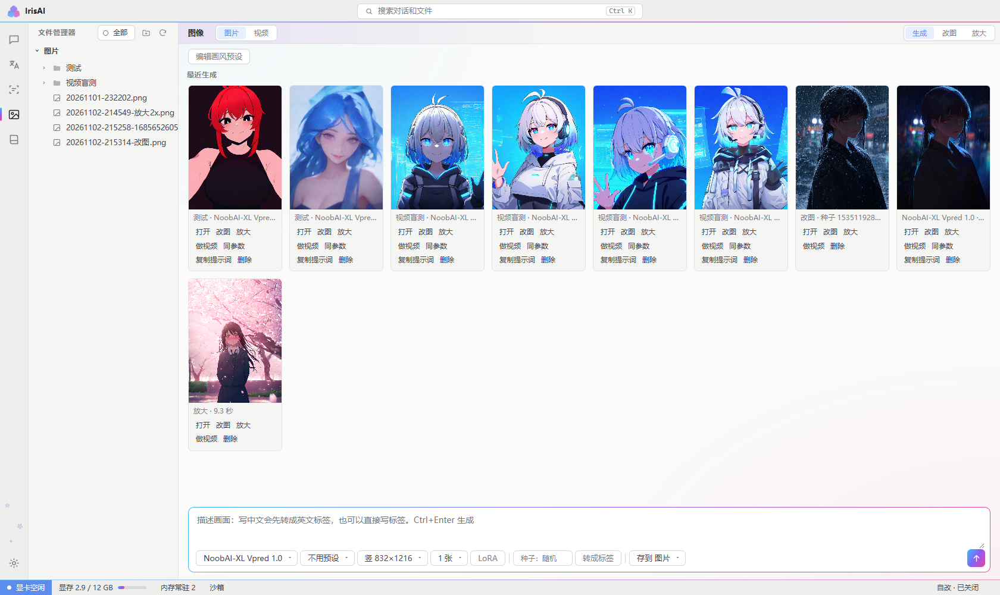
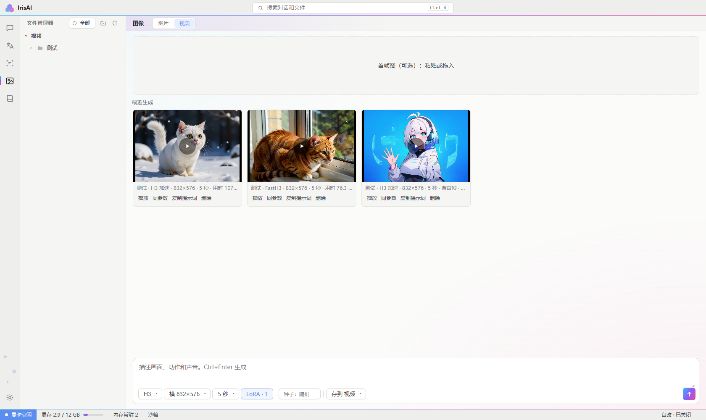
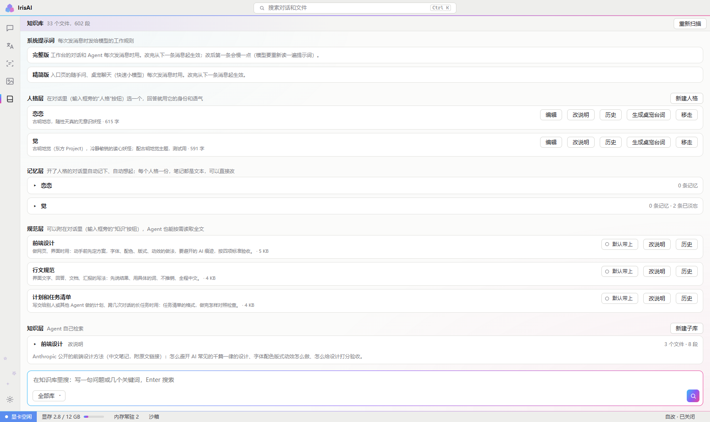
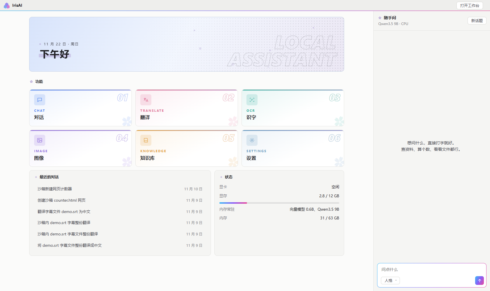
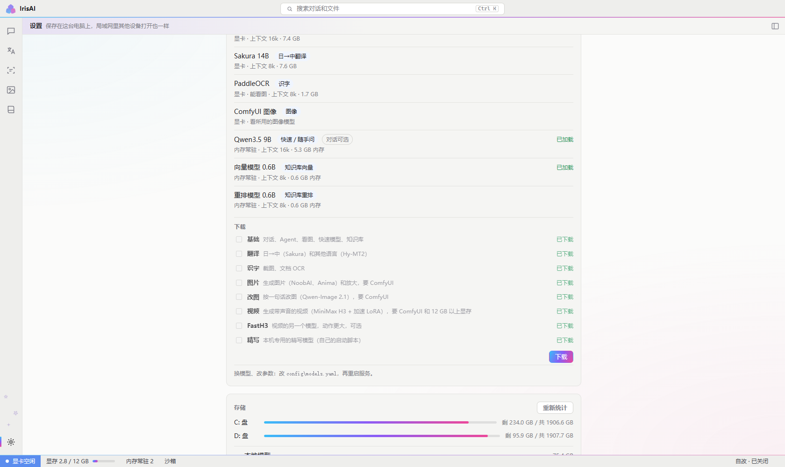
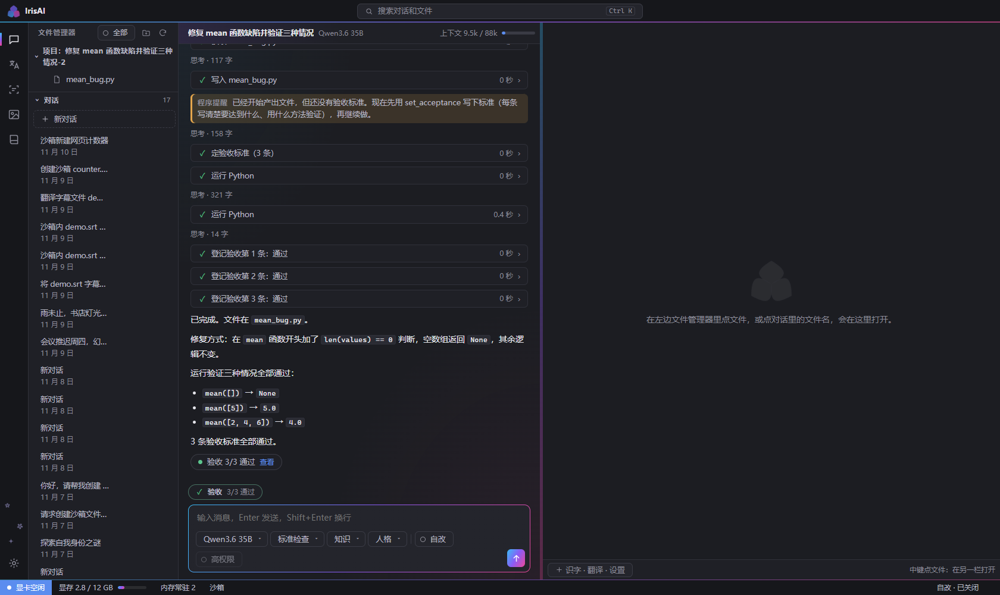

# IrisAI

在自己的 Windows 电脑上运行的 AI 工作台：对话和 Agent、翻译、识字、图片和视频、知识库。模型都在本机运行，除了联网搜索，不向外发送任何内容。界面只有中文。

## 功能

**对话和 Agent。** Agent 在沙箱文件夹里读写文件、运行 Python 和网页脚本、搜索网页。会产出文件的任务，它先定验收标准，做完用代码和截图逐条验证，最后由一个看不到对话的验收员复核。沙箱外的写入和删除先弹卡片，等你确认。

**图片和视频。** 用 ComfyUI 生成图片：二次元用 NoobAI、Anima，写实或者画面里要有中文字用 Qwen-Image 2.1。还能一句话改图、放大到 2 倍或 4 倍。视频用 MiniMax H3，自带声音，可以给一张首帧图；832×576、5 秒的视频在 12 GB 显卡上约 105 秒。可以加自己找的 LoRA，拖进 LoRA 面板就能用。

**翻译。** 贴文字，或者翻译 txt、srt、ass、docx、epub 文件，译文另存一份。日文用 Sakura，其他语言用 Hy-MT2。可以带术语表。

**识字。** 贴截图或拖入图片，识别文字、表格和公式，可以接着翻译或者对图提问。

**知识库。** 把文件放进 `knowledge` 文件夹，Agent 会自己检索。规范（写作要求、设计要求）可以附在对话里。系统提示词也在这里，可以直接改。

**入口页和桌面程序。** 入口页有一个常驻内存的小模型，打开就能问；桌面程序是独立窗口，关掉缩到托盘。

## 电脑要求

| 项 | 要求 |
|---|---|
| 系统 | Windows 10 或 11 |
| 显卡 | NVIDIA，12 GB 显存（默认模型按这个选；显存小就在 `config\models.yaml` 换小一点的模型） |
| 内存 | 32 GB 以上 |
| 硬盘 | 只装基础部分约 32 GB，全部约 155 GB |
| Python | 3.11 以上（安装时没有会提示用 winget 装 3.12） |

## 安装

1. 下载或克隆这个仓库。
2. 双击 `安装.bat`。它会建 Python 环境、生成登录密码、按功能分组列出模型，你选要下哪些。缺的 llama.cpp、llama-swap、ComfyUI 会一起下载。
3. 装完双击桌面上的 IrisAI（安装最后会问要不要放快捷方式），或者浏览器访问 `http://127.0.0.1:8088`。密码在 `config\api_key.txt`。

下载可以中断，再运行 `安装.bat` 会接着下。以后要加功能，在网页的“设置 → 模型”里勾选下载。

| 分组 | 内容 | 大小 |
|---|---|---|
| 基础（必装） | 对话和 Agent（Qwen3.6 35B）、快速小模型（Qwen3.5 9B）、知识库向量和重排 | 30 GB |
| 翻译 | Sakura 14B、Hy-MT2 7B | 16 GB |
| 识字 | PaddleOCR-VL 1.6 | 2 GB |
| 图片 | NoobAI-XL、Anima 2.9B、RealESRGAN | 12 GB |
| 改图 | Qwen-Image 2.1（改图，也用来生成写实和带字的图） | 17 GB |
| 视频 | MiniMax H3、加速 LoRA | 44 GB |
| FastH3 | 另一个视频模型，动作更大 | 22 GB |

## 使用

- 服务没运行时，桌面程序会先启动它；也可以在安装时设成开机自动启动。
- 局域网访问：把 `config\hub.json` 的 `host` 改成 `0.0.0.0`，重启服务，用 `http://<这台电脑的 IP>:8088` 打开。
- 显卡同一时间只放一个模型，切换功能时自动换；空闲 15 分钟自动卸载。
- 对话接口和 OpenAI 兼容：`http://127.0.0.1:8080/v1`，请求头带 `Authorization: Bearer <密码>`。

## 换模型

模型都写在 `config\models.yaml`（第一次安装时从 `config\models.example.yaml` 复制）：每个模型的文件、参数、用途、下载地址，以及各功能用哪个模型。改完重启服务就生效，调度器的配置会按它重新生成。文件里有每个字段的说明。

## 主题

设置里可以换深浅色、强调色、圆角、字号。自己做主题见 [themes/README.md](themes/README.md)。

## 文件夹

| 位置 | 内容 |
|---|---|
| `hub\` | 网页服务（Python）和网页 |
| `scripts\` | 安装、下载、启动、桌面程序 |
| `config\` | 配置示例；你自己的配置和密码也在这里，不会上传 |
| `sandbox\` | Agent 的工作文件夹，生成的图片、视频、译文都在这里 |
| `knowledge\` | 知识库、规范、人格、系统提示词 |

## 许可

代码用 MIT 许可。附带的 marked、DOMPurify 保留各自的许可。模型各有许可，下载前看模型页面；其中 Qwen-Image 2.1 只能非商业使用。
